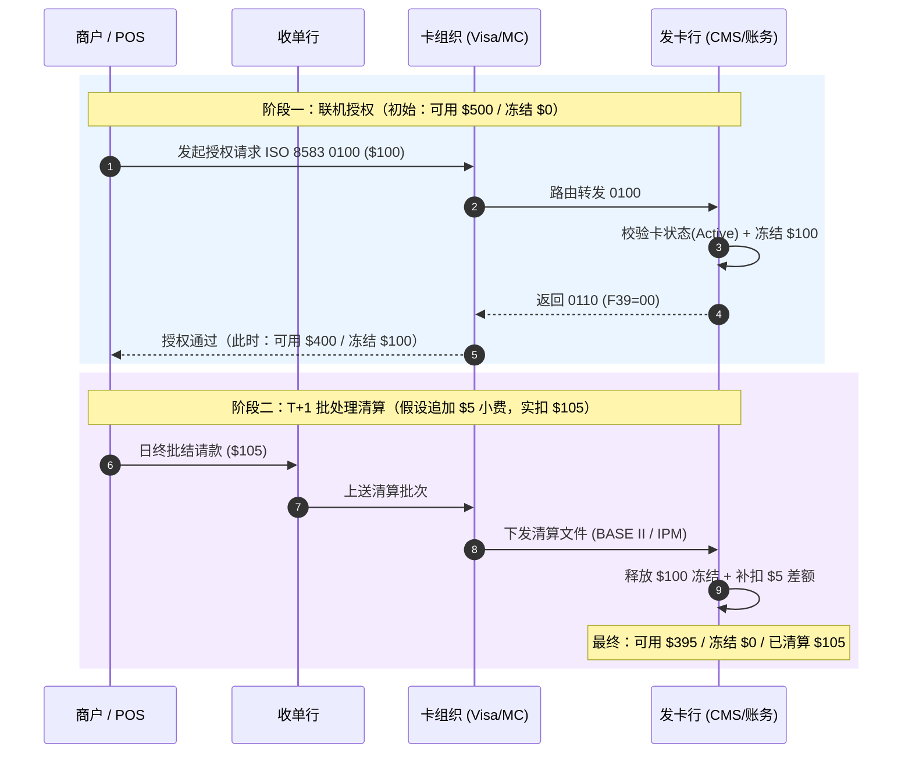

# Module 1：支付基石与卡管理系统（CMS）状态机

## 1. 联机授权（Authorization） vs 批处理清算（Clearing）

| 维度 | 阶段一：联机授权（Authorization） | 阶段二：批处理清算（Clearing & Settlement） |
| :--- | :--- | :--- |
| **发生时间** | 实时（毫秒至秒级） | T+1 至 T+N（通常隔日凌晨批处理） |
| **通信方式** | 联机实时报文（ISO 8583 `0100`/`0110`） | 批量清算文件（Visa BASE II / Mastercard IPM） |
| **资金动作** | **仅冻结额度**（可用减少，冻结增加） | **实际扣款核销**（释放冻结，真实划拨） |
| **测试核心** | 响应速度、余额校验、风控拦截、超时冲正 | 金额差异（小费/汇率）、长短款对账、重复清算幂等 |

### 授权与清算双链路数据流（$100 消费示例）

## 2. CMS 卡生命周期状态机

- **Inactive（未激活）：** 不可消费，通常不可绑钱包。
- **Active（正常）：** 允许消费、绑卡、调额。
- **Frozen（临时冻结）：** 可逆，拦截新授权，但需注意在途清算与退款。
- **Lost / Stolen（挂失）：** 不可逆，触发换卡（Reissue）。
- **Closed（已销卡）：** 终态，销卡前需校验在途冻结资金。

## 3. 面试提炼（Shift-Left）
在需求评审阶段，先画**卡状态机矩阵**与**资金流向图（可用/冻结/清算）**，重点挑刺非正常状态下的清算/退款处理以及销卡时的在途资金校验。